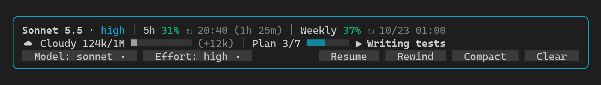
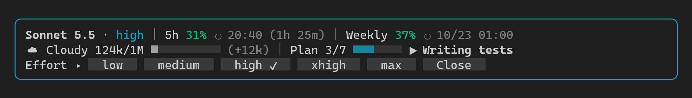
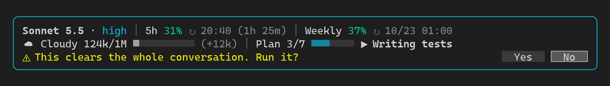

[English](README.md) | **한국어** | [日本語](README.ja.md)

# Cockpit

프롬프트 위에 조종석을 만들어 주는 Claude Code mod입니다. 모델과 effort, 사용량 한도, 날씨 예보 형태의 컨텍스트 창 상태, 현재 플랜의 진행률을 보여 줍니다. 또 실행 전에 확인을 거치는 Resume, Rewind, Compact, Clear 버튼과, 명령어를 입력하지 않고 모델과 effort를 바꾸는 선택기도 제공합니다.

<!-- IMAGE 1: 밴드 전체(3줄, 테두리 포함)가 보이는 화면. 파일명: screenshots/cockpit-overview.png -->


## 제공 기능

```text
╭──────────────────────────────────────────────────────────────────────────╮
│ Sonnet 5.5 · high │ 5h 31% ↻ 20:40 (1h 25m) │ Weekly 37% ↻ 10/23 01:00   │
│ ☁ Cloudy 124k/1M ▓░░░░░░░░░ (+12k) │ Plan 3/7 ▓▓▓░░░░ ▶ Writing tests   │
│ Model: sonnet ▾  Effort: high ▾          Resume  Rewind  Compact  Clear  │
╰──────────────────────────────────────────────────────────────────────────╯
```

| 줄 | 보여 주는 내용 |
| --- | --- |
| 1 | 세션의 모델과 effort, 그리고 사용량 한도 두 개(5시간, 주간)와 각 한도가 리셋되는 시각 |
| 2 | 컨텍스트 창 예보와 현재 플랜의 진행률 |
| 3 | 왼쪽에 모델·effort 선택기, 오른쪽에 Resume / Rewind / Compact / Clear 버튼 |

**모델과 effort.** 모델 이름은 세션에서 읽어 옵니다. 예를 들어 `claude-sonnet-5-5`는 `Sonnet 5.5`로 표시됩니다. effort 앞의 `⚠`는 마지막 요청이 사용자가 고른 effort와 다른 값으로 전송되었다는 뜻입니다.

**사용량 한도.** 각 한도는 사용률을 보여 주며 70% 미만은 초록, 70% 이상은 노랑, 90% 이상은 빨강입니다. 리셋 시각은 24시간 이내이면 `HH:MM (남은 시간)`, 그 이후이면 `M/D HH:MM` 형식이며 로컬 시간입니다. Claude Code가 계정의 한도를 알려 주지 않으면 한도 칸은 숨깁니다.

**컨텍스트 예보.** 창 대비 퍼센트가 아니라 컨텍스트에 쌓인 토큰 수로 정합니다.

| 컨텍스트 토큰 | 예보 |
| --- | --- |
| 100k 미만 | ☀ Sunny |
| 100k – 199k | ☁ Cloudy |
| 200k – 399k | ☂ Rain (노랑) |
| 400k 이상 | ⛈ Storm (빨강) |

옆에는 창 대비 사용 토큰, 10칸 막대, 마지막 턴에서 늘어난 양(예: `(+12k)`)이 표시됩니다.

**플랜 진행률.** Claude가 todo·task 도구로 관리하는 플랜을 읽어서 `Plan 완료/전체`, 7칸 막대, `▶` 뒤에 진행 중인 단계를 보여 줍니다. 모든 단계가 끝나면 `✔ All done`이 표시됩니다. 플랜이 없으면 이 부분은 숨겨집니다.

**버튼.** Resume, Rewind, Compact, Clear는 처음 눌렀을 때 바로 실행되지 않습니다. 아래 줄이 `⚠ This clears the whole conversation. Run it?` 같은 질문으로 바뀌고 Yes, No 버튼이 나타납니다. No에 포커스가 있어서 Enter를 누르면 취소됩니다. 질문은 10초가 지나거나, Esc를 누르거나, 새 턴이 시작되면 저절로 닫힙니다. Claude가 작업 중일 때는 버튼이 흐리게 표시되고, 누르면 짧은 안내만 나옵니다.

**선택기.** 모델 또는 effort 버튼을 누르면 선택지 행이 펼쳐지고, 현재 값에는 `✔`가 붙습니다.

- 모델: `haiku`, `sonnet`, `opus` 중 현재 Claude Code가 제공하는 것만 보여 줍니다. 컨텍스트가 200k 토큰 이상이면 먼저 확인을 받습니다. 모델을 바꾸면 캐시가 다시 만들어지기 때문입니다.
- Effort: `low`, `medium`, `high`, `xhigh`, `max`

**`/cockpit-status`** 는 mod가 읽는 값(컨텍스트, 한도, 모델, effort 출처, 플랜, 동작별로 마지막에 성공한 경로)을 출력합니다. 화면이 이상할 때 사용하세요.

밴드는 사용할 수 있는 공간에 맞춰 줄어듭니다. 줄 수가 모자라면 테두리를 없애고, 그다음 1·2줄을 합치고, 그다음 한 줄만 보여 줍니다. 폭이 모자라면 단계 이름, 플랜 막대, 컨텍스트 막대, 마지막 턴 증감, 리셋 시각 순으로 세부 정보를 덜어 냅니다.

<!-- IMAGE 2: 모델 또는 Effort 버튼을 눌러 선택지 행이 펼쳐진 화면. 파일명: screenshots/cockpit-picker.png -->


<!-- IMAGE 3: Compact 또는 Clear 버튼을 눌러 확인 질문(Yes / No)이 뜬 화면. 파일명: screenshots/cockpit-confirm.png -->


## 동작 방식

이 mod는 hooks 모듈 하나(`hooks/register.tsx`)와 순수 함수 모음(`hooks/lib.ts`)으로 구성됩니다. 모델을 호출하지 않고 네트워크로 아무것도 보내지 않습니다.

| Hook | 하는 일 |
| --- | --- |
| `session.start` | 처음 값을 읽고, 저장해 둔 effort 선택을 되살리고, 리셋 카운트다운용 1분 타이머를 시작하고, `/cockpit-status`를 등록합니다. |
| `session.measure` | Claude Code가 컨텍스트와 사용량 한도를 측정할 때마다 값을 갱신합니다. |
| `turn.start` | 열려 있는 질문과 선택기를 닫습니다. 서브에이전트 턴은 건너뜁니다. |
| `turn.step` | 요청이 실제로 싣는 effort를 기록하고, 다른 경로를 쓸 수 없을 때 사용자가 고른 effort로 덮어씁니다. |
| `turn.complete` | 메인 루프 턴이 끝날 때마다 사용량, 플랜, 모델을 갱신합니다. |
| `command.run` (`/cockpit-status`) | 진단 문구로 응답합니다. |
| `command.run` (`/effort`) | 직접 입력한 effort를 새 선택값으로 삼습니다. |
| `classic.SessionStart` | `/clear`, `/resume`, fork 뒤에 값을 다시 읽습니다. |
| `session.end` | clear와 resume 때 대기 중인 질문과 사용량 값을 비웁니다. |
| `ui.focus` (`{component: "AbovePrompt"}`) | 포커스가 밴드를 벗어나면 질문과 선택기를 닫습니다. |
| `ui.render` (`{component: "AbovePrompt"}`) | 밴드를 그립니다. |

각 버튼은 일을 처리하는 방법을 여러 개 가지고 있고 처음으로 성공하는 방법을 씁니다. Claude Code가 바뀌어도 버튼이 먹통이 되지 않게 하기 위해서입니다.

- **Compact:** 세션의 compact 호출 → `/compact` 명령 → 프롬프트에 `/compact`를 입력해 두기(Enter로 직접 실행)
- **Clear, Resume, Rewind:** 해당 명령 → 프롬프트에 명령 입력해 두기
- **Effort:** effort 설정 → `/effort` 명령 → 다음 요청에 덮어쓰기

모든 방법이 실패하면 직접 입력할 명령을 안내합니다.

## 실행하기

**요구 사항**

- Claude Code 2.1.303 이상. `claude plugin validate`와 `claude plugin test`가 2.1.303에서 통과합니다. 더 낮은 버전은 테스트하지 않았습니다.
- 터미널 환경. 밴드는 터미널 화면의 프롬프트 위에 그려집니다.

환경 변수나 설정은 필요 없습니다.

**이 저장소에서 설치**

```bash
claude plugin marketplace add Hugo-Jang/claude-cockpit-mods
claude plugin install cockpit-mods@claude-cockpit-mods --scope user
```

Claude Code 세션 안에서는 다음과 같이 입력합니다.

```text
/plugin install cockpit-mods --marketplace Hugo-Jang/claude-cockpit-mods
```

밴드가 보이려면 Claude Code를 다시 시작하거나 `/reload-plugins`를 실행하세요.

**설치하지 않고 한 세션만 사용**

```bash
git clone https://github.com/Hugo-Jang/claude-cockpit-mods.git
cd claude-cockpit-mods
claude --plugin-dir ./cockpit
```

**개발과 테스트**

```bash
claude plugin validate ./cockpit
claude plugin test ./cockpit
```

## 참고 / 제한 사항

- **예보는 퍼센트가 아니라 토큰 수로 정합니다.** 1M 토큰 창에서도 `☁ Cloudy`는 100k 토큰부터 시작하며, 이는 창의 10%에 불과합니다. 옆의 막대가 창 대비 퍼센트를 보여 줍니다.
- **사용량 한도는 계정에 따라 다릅니다.** Claude Code가 알려 주지 않으면 추측하지 않고 해당 칸을 숨깁니다.
- **플랜은 Claude의 todo·task 도구에서 가져옵니다.** Claude가 글로만 설명한 계획은 보이지 않습니다.
- **버튼은 Claude가 끝나기를 기다립니다.** 작업 중에는 버튼이 흐려지고, 눌러도 안내만 나옵니다.
- **덮어쓰기 경로로 고른 effort는 다음 요청부터 적용됩니다.** mod가 이 값을 세션 사이에도 유지합니다. 나머지 두 경로는 바로 적용됩니다.
- **모델을 바꾸면 프롬프트 캐시가 다시 만들어져서** 다음 턴에 토큰이 더 쓰일 수 있습니다. 그래서 컨텍스트가 클 때는 먼저 확인을 받습니다.
- **세션당 밴드는 하나입니다.** 프롬프트 위에 그리는 다른 플러그인과는 같은 자리를 두고 겹칩니다. Claude Code의 설문이 표시되는 동안에는 밴드가 비켜 줍니다.
- **밴드 안의 문구는 영어뿐입니다.**

## 의존성

| 이름 | 버전 | 라이선스 (SPDX) | 출처 |
| --- | --- | --- | --- |
| 없음 | | | |

## 서드파티 고지

없음.

## 작성자

[Hugo-Jang](https://github.com/Hugo-Jang)

## 라이선스

[MIT](../LICENSE)

---

있는 그대로 공유합니다. Anthropic 공식 제품이 아니며, 지원이나 유지보수를 보장하지 않습니다.
