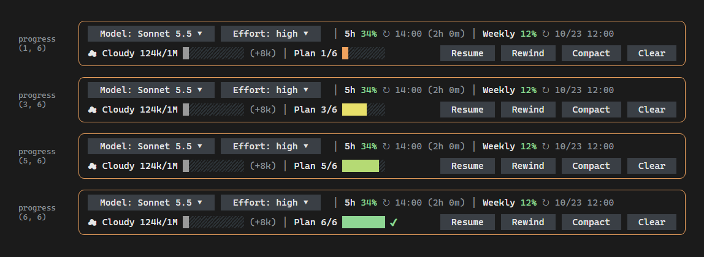
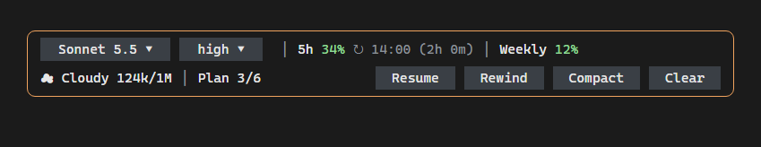

[English](README.md) | [한국어](README.ko.md) | [日本語](README.ja.md)

# Cockpit

A Claude Code mod that puts a cockpit above your prompt. It shows the model and effort, your usage limits, a weather-style forecast of the context window, and a progress bar for the step-by-step work Claude is doing. It also gives you buttons for Resume, Rewind, Compact and Clear that ask for confirmation before they run, and pickers to switch the model and effort without typing a command.

<!-- IMAGE 1: 밴드 전체(2줄 + 테두리)가 보이는 화면. 파일명: screenshots/cockpit-overview.png -->


## What this shows

```text
╭──────────────────────────────────────────────────────────────────────────────────────────────────╮
│ [Model: Sonnet 5.5 ▾] [Effort: high ▾] │ 5h 31% ↻ 20:40 (1h 25m) │ Weekly 37% ↻ 10/23 01:00      │
│ ☁ Cloudy 124k/1M ▓░░░░░░░░░ (+12k) │ Plan 3/6 ▓▓▓▓░░░       [Resume] [Rewind] [Compact] [Clear] │
╰──────────────────────────────────────────────────────────────────────────────────────────────────╯
```

| Row | What it shows |
| --- | --- |
| 1 | The model and effort pickers, then your two usage limits (5-hour and weekly) with the time each one resets. |
| 2 | A forecast of the context window and the progress bar on the left, and the Resume / Rewind / Compact / Clear buttons on the right. |
| 3 | Only while a question or a picker is open: its row appears here, below the band. |

**Model and effort.** The model picker shows the model name read from the session, for example `claude-sonnet-5-5` is shown as `Sonnet 5.5`. A `⚠` before the value on the effort picker means the last request was sent with a different effort than the one you picked.

**Usage limits.** Each limit shows the percent used, colored green below 70%, yellow from 70%, and red from 90%. The reset time reads `HH:MM (time left)` when it is within 24 hours, and `M/D HH:MM` after that, in your local time. If Claude Code does not report limits for your account, the limit cells are hidden.

**Context forecast.** The forecast is based on how many tokens are in the context, not on the percent of the window:

| Tokens in context | Forecast |
| --- | --- |
| under 100k | ☀ Sunny |
| 100k – 199k | ☁ Cloudy |
| 200k – 399k | ☂ Rain (yellow) |
| 400k and up | ⛈ Storm (red) |

Next to it are the tokens used out of the window, a 10-cell bar, and how much the last turn added, for example `(+12k)`.

**Plan progress.** The mod registers a small tool, `progress(done, total)`, and Claude calls it when it works through steps. The band shows `Plan done/total` and a 7-cell bar whose color follows the progress, from orange (1–33%) through yellow (34–66%) and light green (67–99%) to green when every step is done. When all steps are done, a bold green `✔` follows the bar. No step name is shown. Before the first call, this part is hidden.



To get the bar, ask for it in your prompt, for example "step by step" (or "one at a time", "show progress"). The tool's description tells Claude to call it for work of three steps or more, and when you use those words. Claude's todo and task tools are not read.

**Buttons.** Resume, Rewind, Compact and Clear never run on the first press. A row with a question appears below the band, for example `⚠ This clears the whole conversation. Run it?`, with Yes and No buttons. No is focused, so pressing Enter cancels. The question closes by itself after 10 seconds, when you press Esc, or when a new turn starts. A button is dimmed while Claude is working, and pressing it shows a short notice instead.

**Pickers.** Press the model or effort button to open a row of choices. The current one is marked `✔`.

- Model: `haiku`, `sonnet` and `opus`, limited to the ones your Claude Code offers. If the context holds 200k tokens or more, the mod asks first, because switching the model rebuilds the cache.
- Effort: `low`, `medium`, `high`, `xhigh` and `max`.

**`/cockpit-status`** prints the values the mod reads (context, limits, model, effort source, plan, and which path last worked for each action). Use it when something looks wrong.

The band is always drawn as a full box, whatever the height. With fewer columns it drops details in this order: on row 1, the picker prefixes (`Model:`, `Effort:`), the weekly reset, then the 5-hour reset; on row 2, the step name, plan bar, context bar, then the last-turn change.



<!-- IMAGE 2: 모델 또는 Effort 버튼을 눌러 선택지 행이 펼쳐진 화면. 파일명: screenshots/cockpit-picker.png -->


<!-- IMAGE 3: Compact 또는 Clear 버튼을 눌러 확인 질문(Yes / No)이 뜬 화면. 파일명: screenshots/cockpit-confirm.png -->


## How it works

The mod is one hooks module, `hooks/register.tsx`, with pure helper functions in `hooks/lib.ts`. It makes no model calls and sends nothing over the network.

| Hook | What it does |
| --- | --- |
| `session.start` | Takes a first reading, restores your saved effort choice, starts a one-minute tick for the reset countdown, and registers `/cockpit-status` and the `progress` tool. |
| `tool.call` with `progress` | Stores the plan at once from the call, so the bar does not wait for the end of the turn. |
| `session.measure` | Updates the context and usage limits whenever Claude Code measures them. |
| `turn.start` | Closes any open question or picker. Subagent turns are skipped. |
| `turn.step` | Records the effort each request carries, and applies the effort you picked when the other paths are not available. |
| `turn.complete` | Refreshes usage, plan and model after each main-loop turn. The plan is read from the `progress` calls in the transcript. |
| `command.run` with `/cockpit-status` | Answers with the diagnostic text. |
| `command.run` with `/effort` | Treats an effort you type by hand as your new choice. |
| `classic.SessionStart` | Reads everything again after `/clear`, `/resume` and fork. |
| `session.end` | Clears the pending question and the usage reading on clear and resume. |
| `ui.focus` with `{component: "AbovePrompt"}` | Closes the question and the picker when focus leaves the band. |
| `ui.render` with `{component: "AbovePrompt"}` | Draws the band. |

Each button tries several ways to do its job and uses the first that works, so a change in Claude Code does not leave you with a dead button:

- **Compact:** the session's compact call, then the `/compact` command, then it types `/compact` into the prompt for you to run with Enter.
- **Clear, Resume, Rewind:** the matching command, then typing it into the prompt.
- **Effort:** the effort setting, then the `/effort` command, then an override on your next request.

If every way fails, a notice tells you the command to type yourself.

## Run it

**Requirements**

- Claude Code 2.1.303 or later. `claude plugin validate` and `claude plugin test` pass on 2.1.303 and 2.1.306; older versions were not tested.
- A terminal. The band is drawn above the prompt, on the terminal surface.

No environment variables or configuration are needed.

**Install from this repository**

```bash
claude plugin marketplace add Hugo-Jang/claude-cockpit-mods
claude plugin install cockpit-mods@claude-cockpit-mods --scope user
```

Or, inside a Claude Code session:

```text
/plugin install cockpit-mods --marketplace Hugo-Jang/claude-cockpit-mods
```

Restart Claude Code, or run `/reload-plugins`, so the band appears.

**Try it for one session, without installing**

```bash
git clone https://github.com/Hugo-Jang/claude-cockpit-mods.git
cd claude-cockpit-mods
claude --plugin-dir ./cockpit
```

**Develop and test**

```bash
claude plugin validate ./cockpit
claude plugin test ./cockpit
```

## Notes / limitations

- **The forecast counts tokens, not percent.** On a 1M-token window, `☁ Cloudy` starts at 100k tokens, which is only 10% of the window. The bar next to it shows the percent of the window.
- **Usage limits depend on your account.** If Claude Code does not report them, those cells are hidden instead of guessed.
- **The plan comes from the `progress` tool only.** Claude's todo and task tools, and a plan that Claude only describes in text, are not shown. A small model may skip the call; ask "step by step" to prompt it.
- **The tool adds a little to each request.** Its description, about 100 tokens, is sent with every request. Each update costs about 20 output tokens.
- **Buttons wait for Claude.** While Claude is working they are dimmed, so a press only shows a notice.
- **An effort picked with the override path applies from the next request**, and the mod keeps it across sessions. The other two paths apply it right away.
- **Switching the model rebuilds the prompt cache**, so the next turn may use more tokens. That is why the mod asks first on a large context.
- **One band per session.** Another plugin that draws above the prompt competes for the same place. The band steps aside while a Claude Code survey is showing.
- **The text in the band is in English only.**
- **The band always draws its full box.** It needs at least 4 rows (5 while a question or a picker is open). On a shorter terminal it can overlap the prompt.

## Dependencies

| Name | Version | License (SPDX) | Source |
| --- | --- | --- | --- |
| None | | | |

## Third-party notices

None.

## Author

[Hugo-Jang](https://github.com/Hugo-Jang)

## License

[MIT](../LICENSE)

---

Shared as-is. Not an official Anthropic product; no support or maintenance is implied.
